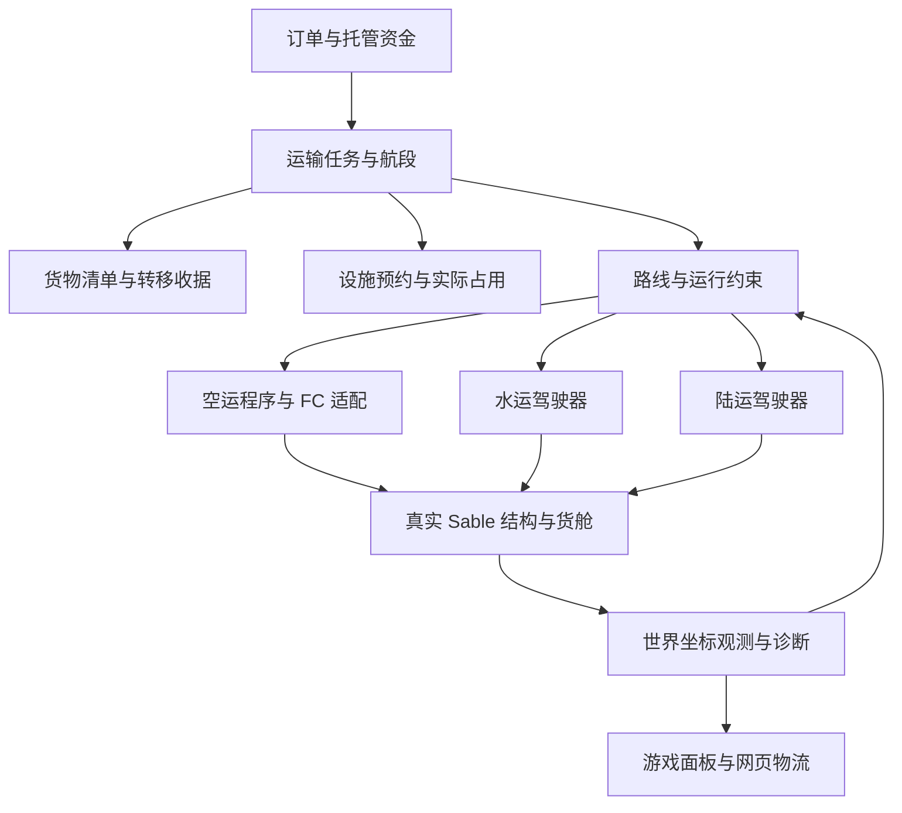

# 航空学物理方块载具自动物流：强化设计与海陆实施边界

日期：2026-10-30。代码基线：`edfa16de3ddde14c34e7707f7c405dcd162c1ccb`，Minecraft 1.21.1 / NeoForge。

**文档状态：详细设计，尚未实施。** 本文沿用用户已选的三类航空器、自建机场登记、近处实体运行和远处有条件离线推进。它不把设计中的自动绕障、性能校准、海陆精确停靠、持久装卸或无缝恢复写成现有能力。旧版运行与验证边界见 [空运接入说明](../../handoff/air-transport/README.md) 和 [上一版验证记录](../../handoff/air-transport/verification.md)。

实施入口：[首批运动安全契约计划](../plans/2026-10-30-physical-logistics-safety-contracts.md)。其余阶段的依赖、文件和验收见本文第 12 节及 [验收矩阵](../../handoff/physical-logistics/acceptance.md)。

## 1. 要达到的运输效果

玩家建造真实方块载具，装上对应登记控制器，选择真实货舱，绑定动力和终端；系统根据这艘船、这辆车、这架飞机**实际能做到的动作**安排物流。装货改变可用性能档位，起步、转弯、减速、等待、停靠与卸货都有可观察的过程。网页显示实际任务和设施状态，故障能解释原因，恢复不会凭空完成订单。

继续使用现有三个登记方块，不新增“万能推进方块”：

| 类型 | 现有登记方块 | 实际执行动力 | 本轮强化重点 |
|---|---|---|---|
| 空运 | `air_vehicle_registration_controller` | 同结构 FC 导航终端与玩家装配的执行器 | 三机型程序、性能约束、进近和复飞、完整停泊 |
| 海运 | `vessel_registration_controller` | 原生油门、舵或差分动力、实际倒车传动 | 吃水、转向水域、低速靠泊、船体漂移 |
| 陆运 | `land_vehicle_registration_controller` | Offroad 轮组、Create 传动、实际转向与刹车 | 可行车曲线、坡度和支承、制动、路口与倒车入位 |

登记方块维持现有零质量配置；正质量来自真实结构。原生 `SailboatEntity` / `CarriageEntity` 与物理方块载具共享订单层，但保留各自驾驶器，不能把实体船的转速、半径或停车语义直接套给方块船。

### 方案比较与选择

| 方案 | 优点 | 问题 | 决定 |
|---|---|---|---|
| 共用物流与设施规则，按介质选择真实控制适配器 | 保留货物、燃料、碰撞和既有市场；可分批迁移 | 要校准真实机械并承认硬件差异 | **采用** |
| 将所有运输交给另一模组录制回放 | 既有站点与回放容易展示 | 第二套路线、控制权、货物权威；回放不等于本项目的真实动力控制 | 只保留未来显式适配边界 |
| 登记器直接施力、传送或移动刚体 | 路径跟随容易统一 | 会绕过玩家动力、燃料和结构性能 | 不作为自动驾驶实现 |

官方 [FC 0.8.3 发布说明](https://www.curseforge.com/minecraft/mc-mods/create-flight-control/files/9313228)提供固定翼与起降改进；本项目实际调用范围以 [FC 接口核对](../../../src/main/java/com/monpai/sailboatmod/compat/flightcontrol/API_EVIDENCE.md)为准。官方 [AL 0.7.0 发布说明](https://www.curseforge.com/minecraft/mc-mods/create-aeronautics-automated-logistics/files/9184782)明确公开支持仍为录制路线回放，新的 Redstone Drive 项目尚未公开可用，不能将其当作现成海陆原生驾驶后端。Sable 版本固定为已核对的 [2.0.6 发布](https://github.com/ryanhcode/sable/releases/tag/mc1.21.1-2.0.6-neoforge)，不因文档日期假定将来版本接口相同。

## 2. 基线事实和优先缺口

下表 Java 路径省略 `src/main/java/com/monpai/sailboatmod/`，网页脚本路径省略 `src/main/resources/`；长类名有唯一文件名简写。行号基于上述提交，实施后以方法名定位。

| 已有内容 | 实际证据 | 尚需加强 |
|---|---|---|
| 稳定业务 UUID、实体/非实体载具入口 | `transport/TransportRef.java`、`transport/LogisticsCarrier.java` | 将业务身份、当前结构组、控制者和任务代次分开持久化 |
| 原生海陆控制 | `transport/NativeNavigationDriver.java:15`、`compat/aeronautics/` | 当前按角度/距离启发式给信号，缺少制动距离、曲率及载荷档位 |
| 真实货舱与本次装货回退 | `transport/SelectedCargoInventory.java`、`CargoLoadReceipt.java` | 进程内收据不是跨重启事务；到达卸货不能先卸全部再猜测回装 |
| 三类机型和 FC 真实航线 | `RegisteredVehicleControllerBlockEntity.java:401`、`FlightRoutePlanner.java` | 飞艇/旋翼同 GENERAL；当前固定油门参数不能代表性能校准 |
| 机场完整停泊、分段扫描和预约 | `block/entity/AirportBlockEntity.java:176`、`:238` | 增加角速度/姿态、连接器、设施修改失效、离场释放与排队 |
| 海陆停车低速检测 | `RegisteredVehicleControllerBlockEntity.java:288` | 水平低速不能证明没有垂直下落、旋转或船体漂移 |
| 海陆泊位范围 | `block/entity/DockBlockEntity.java` 的 `isCarrierInsideDockZone` | 相交不足以证明完整停入；需要货运接点、姿态、支承/水深 |
| 探测和加载窗口 | `transport/control/SweptTerrainProbe.java:26`、`transport/physical/TransportLoadingWindow.java` | AABB 随载具移动变化会重置扫描；大体积可能长期检查前缀，属于静态推导风险，尚未实飞复现 |
| 故障处理 | `RegisteredVehicleControllerBlockEntity.java` 的 `fault` | 海陆故障立即关闭加载窗口；应保留到实际停稳或已交接控制 |
| 网页空运图标、航空高度与设施图层 | `market/logistics/ShippingTraceRecord.java`、`marketweb/map.js` | 需覆盖能力、排队、控制权、诊断、货物确认与海陆设施 |

本轮只做设计核查；没有重新宣称此前测试已证明真实运输。真实飞行、海陆动力运行、Sable 重启和完整付款回路均须按新验收矩阵分别验证。

## 3. 共用架构：物流一致，驾驶按介质分开

### 3.1 权威数据与边界

| 对象（新增设计） | 内容 | 权威来源与限制 |
|---|---|---|
| `PhysicalTransportMission` | missionId、legId、carrierRef、订单引用、阶段、generation、routeRevision、controlLeaseId | SavedData 保存业务状态；不复制货舱 ItemStack |
| `PhysicalObservation` | 主世界维度/位置/姿态、线角速度、结构组、载荷读数、sampleTick、能力位 | 服务端本 tick 的 Sable/适配器观测；缺失值不能填 0 |
| `VehiclePerformanceProfile` | 结构/执行器指纹、载荷范围、速度/转弯/制动/爬升边界、证据级别 | 玩家设置 + 受控校准观测；不假设物品数量必然改变物理质量 |
| `ControlLease` | owner、missionId、generation、mode、nativeRevision、expiresAt | 所有输出携带代次；原生手动控制优先，过期命令不得生效 |
| `RouteEnvelope` | 航段、允许介质、宽高/深度、曲率/坡度、校验覆盖、worldRevision | 预测路线只供规划；出发及进入下一段前需要近场实测证据 |
| `FacilityLease` | dimension、terminalId、facilityId、movementId、revision、期限 | 预约和占用分开；失约不等于场地清空 |
| `CargoTransferRecord` | transferId、batchId、manifestLineId、legId、两端引用、数量、前后摘要、参与者确认、状态 | batchId 标识一次实物操作，generation 仅用于控制者隔离；不能仅凭账本推断任意外部箱子的持久状态 |

保留 `LogisticsCarrier` 作为市场边界，不把整个系统重写。注册控制器继续负责方块/NBT/菜单入口，逐步把运行程序、装卸和诊断抽到上述职责明确的类。现有字段通过版本化迁移读取，新模型准备好之前不删除旧字段。

坐标必须区分：结构局部方块坐标、控制器局部锚点、FC 逻辑原点、主世界位置。保存稳定局部锚点；每次观测统一转换到主世界。货舱 capability 使用本结构实际存储位置，设施、路由和地图使用主世界位置。序列化后重心原点变化不能复用旧偏移。

### 3.2 任务状态

业务流程：`ASSIGNED → PREFLIGHT → LOADING → READY → DEPARTING → EN_ROUTE → APPROACHING → ALIGNING → SECURING → UNLOADING → DELIVERED → RETURNING/IDLE`。

`PREFLIGHT` 先做身份、权限、源设施和目的容量预检查；装载后 `READY` 重新检查性能档位、货舱清单、目的承诺和路线，任一变化都不能沿用空载批准。未装货时等待不应长期锁死整条跑道。

中断状态：`WAITING_TERRAIN / WAITING_FACILITY / MANUAL / RECOVERY_REQUIRED / FAULT`。这些是实际原因，不等于“已暂停所有物理运动”。空中固定翼的安全行为由空运程序决定，绝不能统一输出刹车或取消 FC。正常结束、返程与取消订单分开；退款不意味着可以销毁货舱中的实物。

每次状态跳转检查 `missionId + generation + expectedPhase`。同一消息重送返回已有结果。旧 FC task UUID、旧网络包或旧加载回调不能改变新任务。

### 3.3 控制权

优先级：玩家显式接管 > 已确认的原生控制者 > 本任务自动控制。紧急安全建议不能抢夺玩家已接管的控制权。

接管时撤销本任务租约、停止继续提交自动命令；保留任务、货物及必要加载。空运向真实 FC 请求交接并读取结果，不以 `isContributing=false` 推断动力已经消失。重新启用需要服务端再次验证原生控制、实际位置、货舱与路线；网页按钮只是请求，不直接标记成功。

## 4. 载具性能、检测与优化

### 4.1 性能档案

每架/艘/辆登记一个可版本化档案。基础字段为长度、宽度、高度、局部外形、正总质量、控制器朝向、货舱和执行器指纹、可用制动/倒车/保持动作。按适配器实际可读性记录角速度、质心、轮胎接地、水面等字段；未知明确标记。

空运额外记录：实测安全最低前飞速度、巡航区间、最大爬升/下降率、允许倾斜、转弯半径、起飞及落地滑跑、可控悬停和复飞能力。海运记录满载吃水、桥下高度、低速舵效、停船距离和倒车可用性。陆运记录轴距或实测等效转弯半径、转向速率、坡度、离地间隙和制动能力。

证据分 `DECLARED`（玩家填值）、`OBSERVED`（真实采样）、`VERIFIED`（指定场景重复通过）。自动物流只在批准过的性能范围内运行。静态发现一个螺旋桨或轮胎不能证明存在足够推力、制动或燃料。

方块组成、执行器、轮距、货舱连接改变时档案失效。货物变化必须检查新的载荷指纹和校准范围；只有确实支持库存质量的物理适配器才展示相应质量变化，不伪造重心/质量曲线。

### 4.2 校准流程

玩家在登记的测试区明确启动校准：静态检查 → 低速正反方向校验 → 直线起步/制动 → 左右转向 → 指定载荷复测。默认只读取正常运行数据提出建议，不在运输途中自动试探发动机或改写 FC 增益。

校准有边界、速度上限、超时和人工接管按钮。制动器、倒挡或保持能力未证实则对应动作不可用。固定翼首次校准由玩家飞行并记录；不把尚未能自主飞行的机体交给自动测试。

优化输出具体建议：某航段限速、需要更长跑道、更宽转弯区域、减载、重接转向口、增加燃料储备、修复无响应执行器。可自动应用的范围先限制为**已批准性能范围内的调度速度和路线选择**；会改变机械布线、FC 参数或动力学的操作必须由玩家在停稳时确认。

### 4.3 前瞻距离与路线约束

所有计算使用格、秒、格/秒，tick 时长为模拟时间 1/20 秒；耗时统计使用真实单调时钟，不能混用。

海陆最低前瞻距离：`D = v × reactionSeconds + v² / (2 × conservativeDeceleration) + clearanceMargin`。制动能力未知时无可证明的停车距离，禁止自动出发；发现实际制动弱于档案时降低能力等级，不能继续扩大油门。坡道、湿滑和载荷使用保守实测减速度下界。

陆运曲线速度上限采用 `v² × curvature ≤ approvedLateralAcceleration`；它是规划约束，不替代真实摩擦模型。海运转弯使用已测转弯走廊而非假设瞬时转向。固定翼按其最低可控速度和转弯包络安排绕行，悬停不是固定翼的退路。

### 4.4 稳定扫描与性能预算

把随时变化的整片 AABB 改成**世界网格上的有版本短期扫描任务**。结果保存 cell 范围、terrainRevision、观察时间和已覆盖体积；下一次移动复用仍有效的重叠区，只扫描新进入部分。禁止把未扫描体积折算成 CLEAR。旋转外形按候选姿态的扫掠包络检测；最初可保守外接，必须标明保守拒绝原因。

紧急近场、下一制动/转向包络、远端规划分队列；按最短碰撞时间排序并保证老任务获得服务。已生成但未加载、预测地形、完整实测分别显示。方块改动、流体变化和其他物理载具都能使结果失效；自身体排除依赖结构身份，不能简单忽略脚下所有方块。

候选初始预算：全服每 tick 最多 8192 个方块检测操作，同时受 2 ms 主线程工作预算约束；单任务每次最多 2048。两者先到即让出，数值须基准测试后调整。紧急安全证据不足时减少新派发，海陆提前在已验证范围内减速停稳；固定翼保持已批准飞行，只有原生连续控制能力已验证时才能转向等待/备降程序，不能在未知位置断动力。没有可行安全动作时明确报故障与人工需求，不承诺自动避险成功。

现有每载具 128 区块和全局 16 个请求槽位是基线限制，不直接扩大。新增全局票据配额与任务准入；已在运动的载具优先保留当前机身及制动/转向范围，不能为接新单卸载旧载具。恢复/校准压力达到阈值时停止接新单。重规划按障碍事件触发并节流，避免每 tick 重跑全路线。

## 5. 三种航空器的运行程序

| 环节 | 飞艇 | 旋翼机 | 固定翼 |
|---|---|---|---|
| 出发 | 解锁真实泊位，建立升力，垂直/缓升后离场 | 转子与升力就绪，垂直爬升，再加速转场 | 跑道入口对正、稳定推力、滑跑、抬轮、爬升 |
| 巡航 | 限制大惯量转弯和垂直速率 | 前飞/悬停能力按档案选择 | 维持可控速度，平滑曲线和最小转弯半径 |
| 等待 | 经验证的悬停或低速等待区 | 经验证的悬停点，限制等待燃料 | 已验证盘旋航线/备降航线，不能停在空中 |
| 进近 | 提前减速，避免余速推离泊位 | 对正停机坪上空，受控下降 | 稳定进近走廊，姿态/速度超限则经验证复飞 |
| 停泊 | 防漂移、真实保持/系泊能力、装卸点对齐 | 垂直速度与角速度稳定、支承或真实锁定 | 接地、减速、完整驶离跑道或明确占用跑道卸货 |

这些是 Sailboat 运行程序，不新增虚假的 FC 机型枚举。FC 仍使用 GENERAL / FIXED_WING；具体指令只有在对应适配能力已验证时才能下发。现有 FC 最后两段必须保留“接地点 → 跑道停止点”的语义。

固定翼起飞须核验许可方向、实际机头与跑道方向误差、机体完整包络和当前位置，计算当前位置到许可跑道终端的剩余可用滑跑距离。其值必须覆盖当前载荷档位实测起飞距离及安全余量，并通过抬轮后的出发走廊检查。跑道总长达标不代替剩余距离达标；没有滑行能力时要求玩家先停到登记待命位。

`APPROACHING` 前必须同时具备有效到达预约、未冲突的进近走廊、可用目的货运容量和足够已验证的脱离/复飞空间。**未验证保持控制连续性的原生路线切换能力前，任何空中阶段都禁止 CANCEL→换卡→START 来自动改航、等待或复飞。** 当前 bridge 的改卡需禁用终端，不能将其当成连续控制接口。能力不足时只执行预先提交且原生支持的程序或请求人工接管；存在新安全切换 API 后仍须先准备路线、核对版本/卡片，并取得原生确认。

飞机达到航点、FC COMPLETED 或页面进度 100% 都不等于交货。必须满足完整机体在设施允许体积中、姿态/线角速度稳定、接地或真正系泊保持、接点可用、订单一致，才进入卸货。证明绑定本航段的 `missionId/legId + physicalGroup + facilityId + leaseRevision + geometryRevision`；落在同机场另一设施需显式改派并重验，不能遍历到任一兼容设施就放行。初始候选阈值见验收矩阵，需实际飞机验证后固化。

### 5.1 机场继续设计

保留玩家建造和登记模式，机场登记台仍是现有方块。设施分三层：

1. 起降设施：现有 RUNWAY / HELIPAD / MOORING；记录尺寸、方向、进近体积和适用性能档位。
2. 连接设施：登记滑行道、等待位、跑道等待线、货运停机位及装卸接点；都引用真实已建区域，不生成建筑。
3. 运行规则：跑道方向、冲突组、阶段租约、队列、备降机场和准入能力。

第一阶段允许固定翼在跑道末端停稳装卸，但整条冲突跑道保持占用并明确低吞吐；**不能先显示跑道空闲再让货物传送**。具备真实滑行能力后才开放独立货运停机坪路线。飞艇的 MOORING 区域登记不能被解释为自动获得系泊力；悬空装卸需真实连接器/系泊或已验证的保持能力。

预约目标分“目的容量承诺”和“短期进入许可”。只有等待/复飞/备降能力通过实飞验收的机体，才允许远程出发时仅占接待容量、到达前再申请进近/跑道冲突组。**过渡阶段不能证明这些能力的机体，必须在起飞前获得覆盖预计到达窗口的目的起降许可**；不能依赖会提前到期的短 TTL。许可期间持续核验占用，意外侵入仍按已批准安全程序或人工接管处理，预约不是防碰撞保证。实际占用独立保存；租约过期或飞机暂停都不自动清空占用。离场需机体完全离开冲突体积，失去观测时保守保留并进入核查。

设施变更递增 revision，旧扫描与新几何不能混用。卸载、重启或拆除登记台不释放仍被机体占用的运行区；记录关闭状态，禁新进入，等待实地核验。

## 6. 海运实施设计

在现有码头/城镇仓库上增加 `Berth`、`WaterApproach`、`HoldingArea` 登记数据；第一批复用码头方块和菜单，不先添加新方块。

**路线：** 宽度按转弯时船体扫掠计算；水深必须覆盖本载荷吃水与余量；桅杆/上层建筑检查桥下净空；浅滩、岸边、非水支承、狭窄水道和其他物理船舶单独判断。NBT/Tellus 预测只提供远端候选路线，进港和停车不能沿用起终点无条件通行的旧小船假设。

**驾驶：** 将现有 WATER 分支提取为水运驾驶器。外层计算走廊、目标速度和可行转向；内层调用已经验证的油门/舵/差分动力，不写刚体速度。停船先减推力，再按已校准能力倒车或保持；普通 BRAKE 信号只有连接了对应真实机制才有效。无低速舵效的船不能被要求原地转向，有无差分动力分别配置。

**靠泊：** `IN_CHANNEL → SLOW_APPROACH → ALIGN_BERTH → ARREST_DRIFT → SECURED`。检查船体完整进入泊位、纵横向速度、转艏角速度、朝向偏差、实时吃水与货运接点。没有系泊机制的船必须验证在装卸窗口内持续保持；漂移超限立即停止传货并保留清单，不重新装一整船。

**交通：** 单向狭水道和共用回转池作为冲突资源；先申请出口可用，再进入单车道，避免两船相向各占半条航道。双向对遇优先级持久化并确定性比较，不能双方反复改道。死锁通过退回已登记等待区处理，不传送、不穿船。

首批只支持常规水面船、固定码头和已登记航道。潜艇、可移动港口、水陆两栖途中切换和主动拖曳属于独立后续范围，不能共享一个 Kind 就自动开放。已实测支持的受控锚泊/系泊可作为可选能力。

## 7. 陆运实施设计

在现有驿站/道路网络上增加 `LoadingBay`、`RoadCorridor`、`Intersection`、`PullOff` 登记。复用已建道路；规划出的线、预测道路或未施工路段不能直接视作可驶道路。

**路线：** 按实际轴距/最小转弯半径生成连续可行曲线；检查车身扫掠、车轮支承、坑洞/台阶、纵坡和横坡、离地高度、桥梁/隧道净空。结构强度/桥梁承重如果底层模组没有可验证数据，就显示“未提供”，不杜撰承重吨位。

**驾驶：** `LandGuidance` 输出前视目标、目标速度和前进/倒车段；`LandDriver` 根据实际轮组和传动输出原生信号。换挡必须先减速到批准阈值并验证输出生效，再进入反向；倒车段带长度上限、后方净空和退出条件，不能仅因目标在车后就无限倒车。禁止在油门和刹车接线未校准时自动发车。

海陆路线均区分巡航经过点、减速点和必须停车的终端/让行线，消除每个道路节点都停一次的顿挫。返程按方向、单向规则、离场和进场程序重新规划，不能简单反转航点列表。

**道路权：** 路口、单车道桥和装卸位分别租约。等待线在停车距离之外；出口堵塞则不进入路口。转弯扫掠区域参与冲突检测。优先级采用紧急任务等级、入队时间、稳定 UUID 的确定性顺序；老任务加权防饥饿，紧急任务不能驱逐正在通行的实体。

**停车装卸：** `APPROACH_BAY → ALIGN → REVERSE_IF_APPROVED → HOLD_BRAKE → SECURED`。要求完整车体停入、车轮有有效支承、纵横坡在档案内、3D 速度和角速度稳定、真实驻车能力成立。失去路面/车轮打滑不能因为水平速度很低就交货。

首批为单体轮式载具、固定驿站和已登记道路；拖挂/铰接、多体车组、任意越野和水陆切换需独立能力与校准后加入。原生马车继续原驾驶器，不因新轮式策略改变其既有行为。

可选 [Create Avionics 0.4.0](https://modrinth.com/mod/create-avionics/version/0.4.0)公开描述了 Offroad 车轮的转向/刹车脚本和轮胎读取，适合后续诊断适配评估；这是脚本接口证据，尚未验证 Java 互操作、控制互斥和退出语义，首批不把 CC/Avionics 加为硬依赖。

## 8. 装卸、交付与海陆空联运

### 8.1 单次实物转移

现有市场上架已经扣走的库存继续由现有托管权威管理，不能再次从源箱扣取。登记器只操作玩家明确选择的物流货舱；个人库存不参与装卸或回退。

一个转移以稳定 `transferId` 关联 manifestLineId/legId，每个有限数量的实物批次拥有不可变 `batchId`。重复执行同一批必须复用 batchId；generation 仅用于拒绝旧控制者，不因控制权换代生成另一笔实物转移。流程为：冻结业务清单 → 复核停车和货舱身份 → 模拟双方容量 → 获得 PREPARED 意图的持久确认 → 分批实物转移并记录双方实际结果 → 核验数量守恒 → 批次 COMMITTED → 累加行 confirmedQuantity → 满足该行数量后更新运单/托管结算。插入部分成功只确认实际数量，未确认余量不以新 batchId 盲目重试；先对账确认原批结果，再创建剩余量的新批。目的满仓等待，不掉落、不销毁，也不反复装卸全部个人物品。

**持久一致性限制：** `SavedData.setDirty()` 及自建账本无法与任意第三方 `IItemHandler` 的存盘原子提交。即使增加 write-ahead 日志，也不能声称断电后任意库存恰好一次完成。参与者若能提供版本化持久提交/幂等收据，才允许自动恢复其事务；否则保存双方摘要与未决数量，重启后进入 `RECONCILE_REQUIRED`，锁定相关运单，停止重放和自动退款，等待可信证据或管理员核对。账本不再保存一份可领取的货物副本。

第一次不可逆库存变更前，必须有可核验的持久意图屏障，不能将 `setDirty()` 返回当作存盘成功。若原生 SavedData 无法提供此能力，M0c 需要受控写前日志适配器：业务 ID/摘要和 checksum 写入世界专属追加日志并获得明确持久确认，数据模型仍由 SavedData 保存；写入工作异步，服务端拿到确认后重新核验代次/货舱/停车再操作。IO失败禁转移，不能阻塞游戏线程等待。日志不含第二份可领取库存。即使这样，外部库存没有持久参与确认仍可能需要人工核对；启动时对所有进行中运单、货舱摘要与收据做对账，无日志却出现实物/订单不一致时也隔离，不能视作可重新派发。

该日志是对项目现有 SavedData 持久化约定的限定扩展，仅用于获得明确的写入确认；M0c 必须单独验证恢复顺序、日志截断/校验、磁盘满和归档边界。完成前保持新持久事务能力关闭，不能用内存收据冒充实现。

收货仓对已经 COMMITTED 的 batchId 返回原结果；同一行可以有多个不重叠已确认批次，累计数量达到清单数量才能完成整行。DELIVERED/CLAIMED 订单不能再次插入实物。短货、错货或未决但实物可能已转移的订单不能直接按完整数量结算、退币或重新发货。业务终态、实物归属、资金终态各自留证，只有明确一致才推进。

### 8.2 联运

订单可包含 LAND→WATER→AIR 等多个 leg，每段有独立载具和设施许可。首批继续支持已有单段运单；多段自动换装在单段转移协议稳定后开放。联运交接通过实际中转仓，不在两个移动载具之间凭距离跨空传货。下一段未就绪时停在中转仓，订单显示中转等待，不能结算成用户已收货。

首批延用物品货运；流体、实体/乘客、挂载多刚体运输必须另有适配合同和守恒测试，不能自动跟随物品通道启用。

## 9. 重启、远处运行与补丁

### 9.1 先保证物理任务恢复可解释

持久化任务、实际结构组、路线版本、控制者、货物转移记录和设施占用。重新加载后先识别“未加载、等待身份、已确认损毁、托管中、重复结构”中的哪一种，再决定恢复；`getEntity == null` 或 Sable 暂时查不到不能等同销毁。

现有 FC 不持久化航段进度。第一阶段保留“人工恢复”的诚实行为，补上启动前 fence，避免方块加载先后导致旧卡自动从头启动。若上游没有生命周期入口，需要 FC 0.8.3 的版本限定补丁；接口先审计、探针验证再启用。补丁不注入本模组自动驾驶算法，仅提供加载期间抑制自动启动、核对 profile/revision、确认当前任务状态的契约。尚未实现时不承诺空中无缝续飞。

海陆任务重启默认先读取真实姿态/运动与货物；正在运动时保持必要票据并采取已验证停止/保持策略，停稳后才重新规划。遇未知状态不立即关闭加载，也不自动回到第一航点。

### 9.2 远处离线推进的放行条件

“离线”指服务器仍在 tick、附近无人时的虚拟航段，**不包括服务器关机后的墙钟补跑**。目标仍支持三介质，但当前全部保持物理运行，只有验证过的提供方/结构/燃料组合才逐项开放。

必须具备整个结构组的持久独占托管、物理移除确认、明确 IO 成败、原生加载入口互斥、单次恢复代次、实际燃料扣减和恢复空间校验。具体协议沿用 [存放事务接口证据](../../../src/main/java/com/monpai/sailboatmod/compat/automatedlogistics/API_EVIDENCE.md)，不能伪装成现有 Sable API。

恢复触发距离按最大接近速度、实测加载/恢复 P99 延时与可见半径计算：`R = visibleRadius + (playerMaxSpeed + vehicleMaxSpeed) × recoveryLatency + margin`。传送/跨维度等突发接近不能被有限半径保证覆盖；需要跟踪发布/交互 fence。没有该能力时关闭该区域虚拟切换或明确保持实体，不能在玩家视野内伪造已有飞机。

固定翼恢复必须在第一次可观察物理步之前恢复正确姿态、精确动量和控制权。现有 AL 恢复的停止/重定位路径不满足这个要求。海陆即使允许停稳恢复，也仍需独占托管与货物守恒，不能因速度要求较低跳过事务。存在玩家、乘客、未支持连接体、战斗/交互或未知燃料模型时拒绝切换。

## 10. 玩家操作与网页物流

游戏登记面板保留现有入口，组织为：身份/货舱、动力绑定、性能与校准、路线/设施、运行诊断。每个失败原因提供具体值与可行动建议，例如“满载制动距离 28 格，前方可验证范围 18 格”“跑道宽度不足”“船体右舷仍在泊位外”。不要只显示“异常”。

玩家看到的动作应来自真实执行器：油门和舵按已测响应速率逐步变化，巡航经过点平滑通过，装卸在真实停稳/接点就绪后开始。螺旋桨、轮胎、传动与连接器继续使用其原生状态/动画，不给未运转硬件播放假推进效果。调试叠加层显示实际包络、扫掠区、停车距离、设施准入区和证据年龄；它是诊断信息，不会改变碰撞或让未验证路线看起来可通行。

网页保持现有三类航空图标，并区分实体船/方块船、马车/轮式载具。海陆空统一显示：当前任务阶段、当前段与下一段、实际位置/高度/速度及采样时间、实际控制者、物理/虚拟表示、设施预约/占用、装卸已确认数量、阻塞原因和预计到达区间。

`movementPhase`、`orderStatus`、`representation`、`controlOwner` 独立字段；前端不得由订单“运输中”推断飞机正在巡航。`positionSource` 标明 PHYSICAL_OBSERVATION / VIRTUAL_AUTHORIZED / LAST_KNOWN；无实测高度、燃料、质量时显示未知。ETA 采用当前性能与排队估计，并标示置信度；断连显示最后观测时间，不平滑推演到已交付。

设施图层展示跑道/进近/滑行、泊位/航道、装卸位/路口，以及预约、占用、关闭、待核查。公开地图只发公开设施几何；私人载具、库存、订单和诊断沿用身份/城镇权限。重连、切账号、SSE 重放、缓存命中都重新校验权限，不能靠前端隐藏。

网页命令（继续/取消/接管请求）携带 missionId、generation、expectedRevision 和幂等键，服务端验证权限与能力后执行。查看运单不授予驾驶/管理权限：同国成员可见不等于可控制。默认沿用登记器 owner/admin 和实际世界 8 格范围的管理边界，网页不能绕过距离；远程操作只有在后续明确增加按载具/动作限定、可撤销的委托授权后开放，并逐次校验。离线账号无法证明位置时不提供需要近距离的动作。请求成功与执行完成分开。默认地图刷新 1 Hz，选中目标最多 4 Hz，事件实时入队但有上限与合并；HTTP/SSE 线程不阻塞游戏 tick。

## 11. 量化验收目标

以下是待验证目标，不是当前实测结果：

- 每种机型、水面船、轮式车在空载/中载/批准满载各跑 10 次，共 150 趟指定路线；全部记录起停、货物、支付和接管。实体帆船/马车另做回归。
- 正常路线 150 趟无误交付、货物复制/丢失和非预期控制权争用；零问题样本不代表对任意结构的数学保证。
- 停泊同时检查 3D 线速度≤0.25 格/秒、角速度≤2°/秒、完整包络、设施姿态/接点、有效保持/支承，连续 40 tick 成立后允许传货。阈值为候选默认，实测后按模式收紧；没有角速度数据时新精确装卸能力不予放行。
- 装卸每批复核上述条件；离开有效区域的同一业务 tick 停止下一批转移。已经提交的批次只核对，不撤销为“未发生”。
- 停靠位置/姿态偏差不超过设施批准值；初始朝向误差候选≤5°，船舶/漂浮设施相对姿态须按真实保持机制定义。
- 记录本模组控制、扫描、加载、网页快照分项耗时及队列年龄，报告 P50/P95/P99；在固定测试机、固定视距与相同载具的基线上比较 1/10/30 辆。2 ms 仅是本模组调度目标，不代表 Sable 总物理成本。
- 扫描预算耗尽、目的地堵塞、服务器重启、重复交付、人工拆改、输入乱序均须有可解释状态；没有证据不得标记 CLEAR/SECURED/DELIVERED。

## 12. 实施批次、代码落点与退出条件

本项目分成可独立验收的批次；下表是依赖路线图，不把尚未编写的阶段称为已完成实现。

| 批次 | 修改/新增文件（`src/main/java/com/monpai/sailboatmod/` 下） | 具体交付与退出条件 |
|---|---|---|
| M0a 运动安全契约 | 新增 `transport/physical/safety/MotionSafetyPolicy.java` 及 JUnit | 先固定停车距离、转弯限速、3D停稳、连续样本和旧观测拒绝规则；完整步骤见独立计划。此批不接运行时，不改变驾驶行为 |
| M0b 共用观测与控制 | 扩展 `transport/physical/PhysicalVehicleView`、`compat/aeronautics/SableReflectionAccess`；新增 `transport/physical/observation/PhysicalObservation`、`transport/control/ControlLeaseService`；接入注册 BE | 原生姿态/角速度/身份新鲜度及能力位；把 M0a 接到出发/停泊门禁；重复/乱序/手动接管、错误设施、性能档位变化测试通过。旧实体驾驶器不走新门禁 |
| M0c 装卸与设施一致性 | 新增 `transport/cargo/CargoTransferService`、`CargoTransferSavedData`、`CargoIntentJournal`、`transport/facility/FacilityLeaseService`；修改 `CarrierArrivalService`、`MarketBlockEntity`、`DockBlockEntity`、`AirportBlockEntity` | 按清单批次转移，持久意图屏障和批次收据，短货/重复交付拒绝，未决重启隔离；预约/实际占用分开，精确设施和 token 绑定；测试故障切点，不能只测记录类 |
| M1 稳定探测与加载 | 新增 `transport/control/TerrainScanScheduler`、`transport/control/TerrainEvidence`；修改 `SweptTerrainProbe`、`TransportLoadingWindow` 和注册 BE | 移动包络跨预算完成，未知/过期不会通过，近场优先，故障停稳前保票；全局准入与队列饥饿测试 |
| M2 空运强化 | 新增 `transport/air/FlightProcedureService`、`transport/air/AirframePerformanceProfile`；修改 `FlightRoutePlanner`、`AirportBlockEntity`、FC bridge | 三类起降/等待/备降程序、阶段租约、校准档案；FC不支持动作明确禁用；三机型真实货运验收后才开放对应能力 |
| M3 海运 | 新增 `transport/water/WaterGuidance`、`WaterDockingProcedure`、`WaterClearanceProbe`；修改 `NativeNavigationDriver` WATER、`route/water/RealBlockWaterWorld` 与 Dock | 满载吃水、船体转弯、漂移停止、精确靠泊；原生油门舵/倒车校准，空中 FC 无参与；完成真实船往返交付 |
| M4 陆运 | 新增 `transport/land/LandGuidance`、`RoadClearanceProbe`、`RoadReservationService`；修改 `NativeNavigationDriver` LAND、`LandTransportNetworkService`、PostStation | 可行曲线、坡度支承、提前制动、受控倒车、路口不堵死；完成真实 Offroad 往返交付 |
| M5 联运与网页 | 修改 `market/logistics/ShippingTraceRecord`、`ShippingTraceService`、`market/web/MarketWebServer`；前端位于仓库 `src/main/resources/marketweb/map.js`、`logistics-render.js`；新增权限与迁移测试 | 各阶段随改动增加遥测，M5完成统一设施层及联运；中转仓幂等交接、前端显示未知/过期/待核查，实服截图与 mock 分开 |
| M6 远处托管 | `compat/automatedlogistics/` 的独立版本适配模块及真实上游/扩展补丁 | 物理/存储互斥、燃料、每个崩溃切点、玩家突发接近、多次恢复全部实测后逐组合开放；不能以时间排期绕过放行条件 |

M0b/M0c/M1 完成后，海运/陆运的纯算法、设施模型和测试夹具可以并行准备；运行时入口合并由一个集成人负责。M2/M3/M4 各自交付当前安全可用的子集，不把尚未通过的模式带入默认自动派发。M5 遥测随阶段接入，完整联运依赖 M0c。M6 独立，不阻塞真实物理货运的改进。

### 兼容与开关

旧存档读取必须保留原载具 UUID、订单 ID、原货物与城镇终端；迁移只在版本匹配且核对成功时写入，失败保留原数据并禁新派发。新旧控制循环不能同时驱动同一结构。客户端协议仅在实际修改包结构的实施批次递增；本设计不改变当前协议 17。

建议按提供方/模式设置能力开关 `physicalLogisticsV2.air/water/land`、`durableCargoTransfers`、`hybridTransit`。这些是拟新增配置，当前不存在。新能力默认关闭，独立测试世界通过后启用；关闭配置只停止新任务准入，已有任务按兼容程序停稳/交接并保留货物，不立即撤销空中控制。

### 第一批实施准备已经明确的内容

先做 M0a 的纯运动契约，再接 M0b 的真实观测和 M0c 的货物/设施权威，随后替换 M1 探测。这样海、陆、空使用同一组“何时能够继续、何时算停稳、何时可以交货”的可靠门槛。完整行为仍按上述批次验收，文档提交不等于这些能力已经生效。
